# Intro to Machine Learning

**Практический проект по машинному обучению: от логистической регрессии до кластеризации.**

В этом проекте я работал с данными об учебной активности пользователей: временем отправки решений, количеством попыток, коммитами и просмотрами новостной ленты. На этих данных я последовательно решал три задачи: определял класс объекта, предсказывал числовое значение и искал группы похожих пользователей.

Работа состоит из шести Jupyter Notebook. В каждом упражнении я добавлял следующий элемент рабочего процесса: подготовку признаков, обучение, визуализацию, проверку качества или подбор параметров. Поэтому репозиторий показывает не только финальные модели, но и то, как я учился понимать их поведение.

**Стек:** Python · pandas · NumPy · Matplotlib · scikit-learn · joblib · Jupyter Notebook.

## Содержание

- [Маршрут проекта](#маршрут-проекта)
- [Данные](#данные)
- [Что я делал](#что-я-делал)
  - [Ex00 — первый бинарный классификатор](#ex00--первый-бинарный-классификатор)
  - [Ex01 — масштабирование и границы решений](#ex01--масштабирование-и-границы-решений)
  - [Ex02 — семь классов и категориальные признаки](#ex02--семь-классов-и-категориальные-признаки)
  - [Ex03 — проверка на новых данных](#ex03--проверка-на-новых-данных)
  - [Ex04 — предсказание числового значения](#ex04--предсказание-числового-значения)
  - [Ex05 — поиск групп пользователей](#ex05--поиск-групп-пользователей)
- [Что я вынес из проекта](#что-я-вынес-из-проекта)
- [Как читать результаты](#как-читать-результаты)
- [Структура репозитория](#структура-репозитория)
- [Как запустить](#как-запустить)

## Маршрут проекта

| Упражнение | Задача | С чем я работал |
|---|---|---|
| [Ex00](src/ex00/00_binary_classifier_logreg_RU.ipynb) | Определить, рабочий день или выходной | Даты, агрегация, `LogisticRegression`, наивный классификатор |
| [Ex01](src/ex01/01_binary_classifier_svm_tree_RU.ipynb) | Сравнить границы разных классификаторов | `StandardScaler`, `SVC`, `DecisionTreeClassifier`, `plot_tree` |
| [Ex02](src/ex02/02_multiclass_one-hot_RU.ipynb) | Предсказать один из семи дней недели | `OneHotEncoder`, `OneVsRestClassifier`, `RandomForestClassifier`, важность признаков |
| [Ex03](src/ex03/03_split_crossval_RU.ipynb) | Оценить модели на новых данных | `train_test_split`, стратификация, `cross_val_score`, сохранение модели |
| [Ex04](src/ex04/04_regression_RU.ipynb) | Предсказать среднюю разницу между первым коммитом и дедлайном | Линейная регрессия, дерево, случайный лес, `KFold`, RMSE |
| [Ex05](src/ex05/05_clustering_RU.ipynb) | Объединить похожих пользователей без готовых ответов | `KMeans`, `DBSCAN`, `AgglomerativeClustering`, silhouette score |

## Данные

Исходные данные и часть подготовленных таблиц находятся в [src/data](src/data). Пользователи представлены идентификаторами вида `user_1`.

| Файл | Количество строк | Для чего использовался |
|---|---:|---|
| [`checker_timestamp.csv`](src/data/checker_timestamp.csv) | 3 207 | Временные отметки отправок; подготовка дневной статистики |
| [`am_pm.csv`](src/data/am_pm.csv) | 35 | Коммиты до и после полудня, тип дня и предсказания первой модели |
| [`checker_submits.csv`](src/data/checker_submits.csv) | 1 686 | Пользователь, лабораторная работа, номер попытки и время отправки |
| [`dayofweek.csv`](src/ex02/dayofweek.csv) | 1 686 | Признаки после кодирования и масштабирования; входные данные Ex03 |
| [`checker_regression.csv`](src/data/checker_regression.csv) | 77 | Данные для задачи регрессии, включая пропущенные значения |
| [`regression.csv`](src/data/regression.csv) | 29 | Пользователи для задачи кластеризации |

В разных упражнениях одна строка означает разные объекты: в Ex00–Ex01 это день, в Ex02–Ex03 — отдельная отправка решения, а в Ex05 — пользователь. Регрессия в Ex04 использует отдельную таблицу из 77 строк.

## Что я делал

### Ex00 — первый бинарный классификатор

Первую модель я обучал определять, относится день к рабочим дням или к выходным. Из временных отметок я выделил дату и час, затем сгруппировал отправки по дням и получил два признака:

- `am` — количество коммитов до 12:00;
- `pm` — количество коммитов начиная с 12:00.

Целевая переменная `target` принимала значения `working day` и `weekend`. Сначала я построил scatter plot с настоящими классами: он показал, что группы заметно пересекаются и двух признаков недостаточно для очевидного разделения.

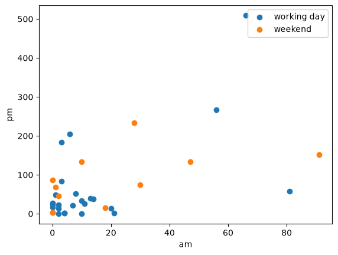

Затем я обучил `LogisticRegression(random_state=21, fit_intercept=False)`, получил предсказания и сравнил accuracy с простым ориентиром — всегда выбирать самый частый класс.

| Подход | Accuracy на тех же данных, на которых обучалась модель |
|---|---:|
| Логистическая регрессия | 62,86% |
| Всегда предсказывать рабочий день | 71,43% |

Этот результат стал первым полезным выводом: обученная модель может уступать простому правилу. Одной цифры accuracy недостаточно — нужен хотя бы базовый вариант для сравнения.

### Ex01 — масштабирование и границы решений

В следующем упражнении я разбирался, как классификаторы разделяют пространство признаков. Для логистической регрессии без свободного члена я получил границу из коэффициентов модели:

```text
w_am · am + w_pm · pm = 0
pm = −(w_am / w_pm) · am
```

После применения `StandardScaler` я повторно обучил модель и построил границу уже в масштабированных координатах. В этом эксперименте accuracy выросла с **62,86% до 74,29%**. Обе оценки получены на обучающих данных.

Дальше я попробовал `SVC` с ядрами `linear`, `rbf`, `poly`, `sigmoid` и дерево решений с разными значениями `max_depth`. Для каждой модели я сравнивал график настоящих классов с графиком предсказаний.

| Логистическая регрессия после стандартизации | SVC с RBF-ядром | Дерево решений |
|---|---|---|
| 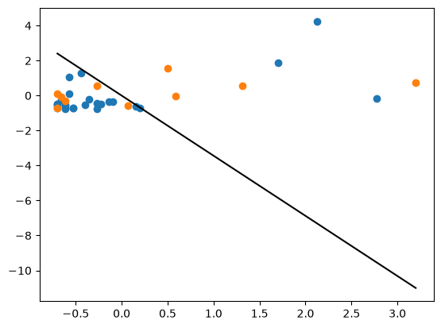 | 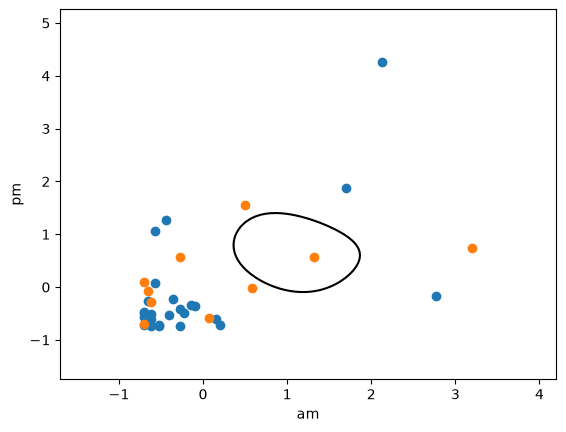 | 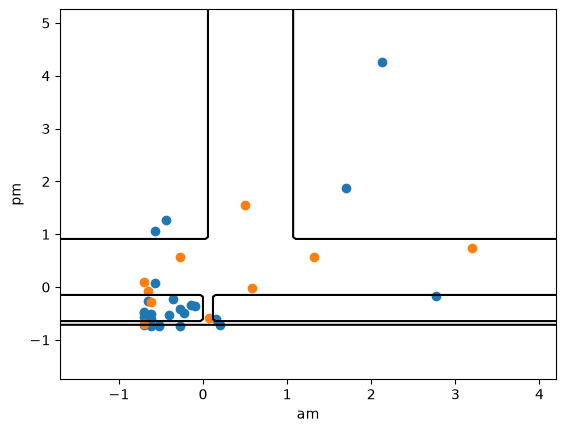 |

На этих трёх графиках показаны настоящие классы: синим отмечены рабочие дни, оранжевым — выходные. Координаты соответствуют стандартизированным `am` и `pm`, чёрная линия — границе решений модели.

Графики помогли связать устройство алгоритма с его результатом: логистическая регрессия строит прямую, SVC с нелинейным ядром — более гибкую границу, а дерево делит пространство порогами по отдельным признакам.

При увеличении глубины дерева с 4 до 6 accuracy на обучающей выборке выросла с **94,29% до 100%**. Позже, в Ex03, я отдельно проверял, почему такой результат ещё не доказывает качество на новых данных.

Я также визуализировал само дерево через `plot_tree`: в узлах можно увидеть условие разделения, количество наблюдений, состав классов и итоговое решение.

<details>
<summary>Посмотреть дерево решений</summary>

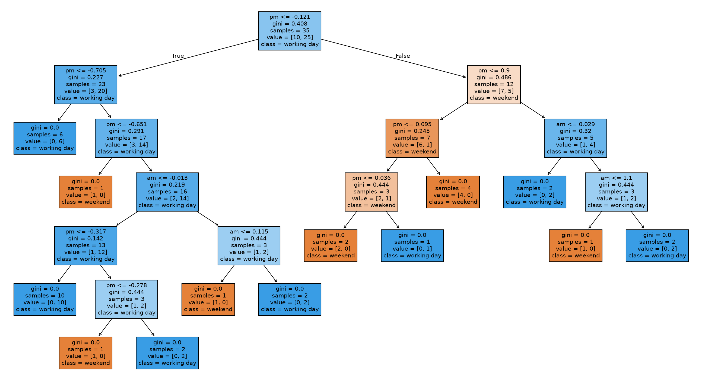

</details>

### Ex02 — семь классов и категориальные признаки

Здесь я перешёл от двух классов к семи: модель должна была предсказывать день недели отправки решения. Признаками стали пользователь, лабораторная работа, час отправки и номер попытки.

Я преобразовал `timestamp` в дату pandas, выделил `hour` и `dayofweek`, закодировал `uid` и `labname` через `OneHotEncoder`, а числовые признаки `hour` и `numTrials` масштабировал. После подготовки получилось **43 признака** и отдельный столбец с целевым классом от 0 до 6.

На этих данных я сравнил логистическую регрессию, SVC, дерево решений и случайный лес. Также попробовал стратегию `OneVsRestClassifier`: отдельный бинарный классификатор для каждого дня недели против всех остальных дней.

Для интерпретации моделей я написал функцию `barh`, которая выбирает наиболее значимые признаки и строит горизонтальную столбчатую диаграмму. Для линейных моделей я использовал сумму модулей коэффициентов по классам, для деревьев и леса — `feature_importances_`. Это разные способы описания модели, поэтому их значения нельзя напрямую сравнивать между собой.

При большой глубине дерево и случайный лес достигли **100% accuracy на обучающих данных**. Именно этот результат стал отправной точкой следующего упражнения: нужно было проверить, что происходит с качеством на примерах, которых модель ещё не видела.

### Ex03 — проверка на новых данных

Я разделил данные на обучающую и тестовую части в отношении **80/20**: 1 348 строк для обучения и 338 для проверки. Сначала посмотрел на обычное случайное разбиение, затем использовал `stratify=y`, чтобы сохранить близкие доли семи классов в обеих частях.

После этого я повторил обучение моделей и оценил предсказания на тесте. Для проверки устойчивости результатов использовал `cross_val_score` с десятью фолдами внутри обучающей части.

| Модель | Accuracy на тесте | Средняя accuracy на CV | Стандартное отклонение CV |
|---|---:|---:|---:|
| Логистическая регрессия¹ | 63,31% | 58,16% | 0,0253 |
| SVC, `kernel="linear"` | 71,60% | 65,87% | 0,0436 |
| Дерево, `max_depth=4` | 52,96% | 50,89% | 0,0319 |
| Случайный лес, 100 деревьев, `max_depth=25` | **92,90%** | **91,77%** | 0,0216 |

¹ В тестовом сравнении использована обычная `LogisticRegression`, а в CV — `OneVsRestClassifier` с логистической регрессией и `solver="liblinear"`. Это разные настройки; их оценки приведены как отдельные эксперименты из ноутбука.

Лучшим из проверенных вариантов оказался случайный лес. Для него я построил диаграмму десяти наиболее важных признаков, сохранил обученную модель через `joblib`, загрузил её обратно и повторил предсказание. После загрузки accuracy осталась прежней — **92,90%**.

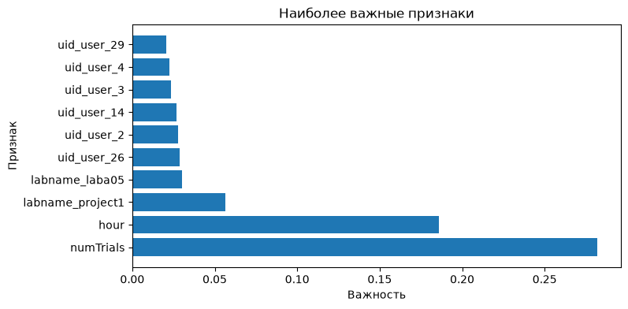

### Ex04 — предсказание числового значения

В регрессии я сменил тип задачи: вместо класса нужно было предсказывать число — `AVG(diff)`, среднюю разницу между первым коммитом и дедлайном. Признаками стали количество коммитов `num_commits` и просмотров ленты `pageviews`; идентификатор пользователя я исключил из `X`.

По условию упражнения я заполнил пропуски нулями, затем разделил 77 строк на **61 обучающую и 16 тестовых**. Для проверки моделей написал собственную функцию `crossval` на основе `KFold`:

1. Получить индексы обучающей и валидационной частей каждого фолда.
2. Выбрать соответствующие строки `X` и `y` через `.iloc`.
3. Обучить модель и сделать предсказания для обеих частей.
4. Вычислить RMSE и вывести среднюю ошибку по валидационным фолдам.

Я сравнил три модели, затем заново обучил каждую на всей обучающей части перед финальной проверкой.

| Модель | Средняя RMSE на 10 фолдах | RMSE на тесте |
|---|---:|---:|
| `LinearRegression(fit_intercept=False)` | 42,29 | 57,41 |
| `DecisionTreeRegressor(max_depth=4)` | 38,55 | 52,21 |
| `RandomForestRegressor(n_estimators=100, max_depth=4)` | **30,14** | **40,46** |

**Чем меньше RMSE, тем лучше.** В этих экспериментах наименьшая ошибка получилась у случайного леса.

Для каждой модели я построил график «фактическое значение — предсказание». Красная пунктирная прямая `y = x` показывает идеальный прогноз: чем ближе к ней точка, тем меньше ошибка для соответствующего наблюдения.

| Линейная регрессия | Дерево решений | Случайный лес |
|---|---|---|
| 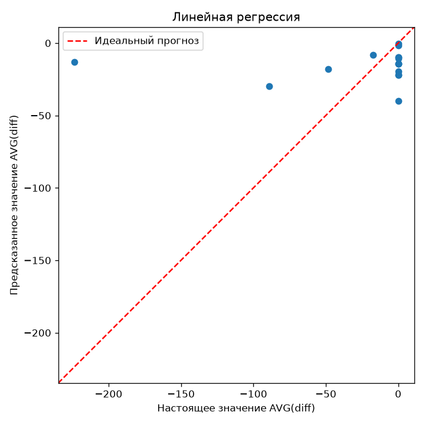 | 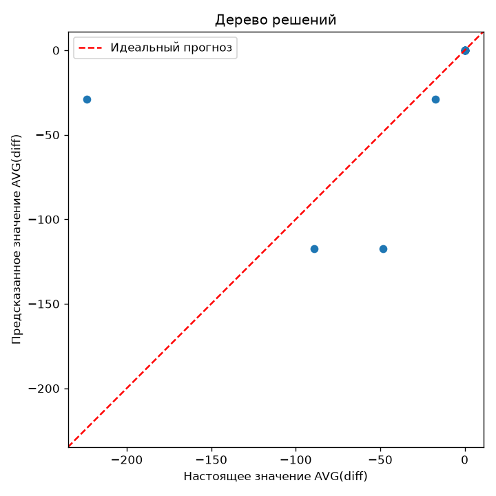 | 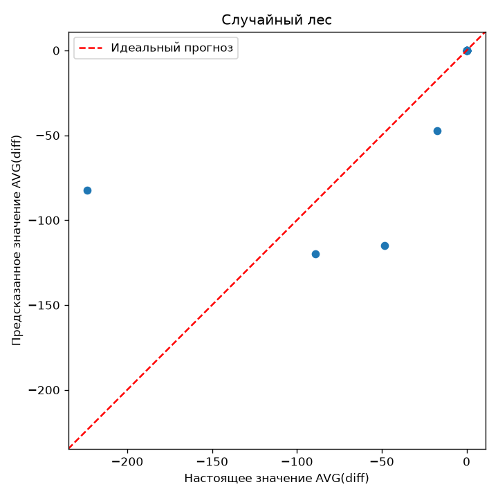 |

### Ex05 — поиск групп пользователей

Последнее упражнение — обучение без учителя. Здесь готовых ответов `y` уже нет: я искал группы пользователей, похожих по количеству коммитов и средней разнице `AVG(diff)`. Для этого использовал отдельную таблицу из 29 пользователей, исключив `pageviews` и не включая `uid` в признаки.

Я попробовал три алгоритма:

- **KMeans** — распределяет точки по заданному количеству кластеров, уточняя их центры.
- **DBSCAN** — объединяет плотные области и может помечать отдельные точки как шум, `-1`.
- **AgglomerativeClustering** — постепенно объединяет отдельные точки и группы до нужного количества кластеров.

Сначала я менял параметры вручную и смотрел, как меняется разбиение. Затем написал общую функцию `vizscore`, которая принимает класс модели, словарь параметров, название изменяемого параметра и диапазон его значений.

Функция обучает модель для каждого значения, вычисляет `silhouette_score`, сохраняет лучшее разбиение и возвращает два подграфика: зависимость оценки от параметра и scatter plot с лучшими найденными кластерами. Если оценку вычислить нельзя, вариант пропускается; если подходящих вариантов нет, функция возвращает `None`.

| Модель | Проверенный диапазон | Лучший параметр в этом диапазоне | Silhouette score |
|---|---|---|---:|
| KMeans, `random_state=21` | `n_clusters`: от 2 до 10 | `n_clusters=8` | 0,4864 |
| DBSCAN, `min_samples=2` | `eps`: от 5 до 60 с шагом 5 | `eps=20` | 0,3834 |
| AgglomerativeClustering | `n_clusters`: от 2 до 10 | `n_clusters=8` | **0,5078** |

В этом сравнении наибольший silhouette score получился у иерархической кластеризации с восемью кластерами. Это результат перебора на выбранных признаках и диапазонах, а не доказательство того, что существует ровно восемь естественных групп пользователей.

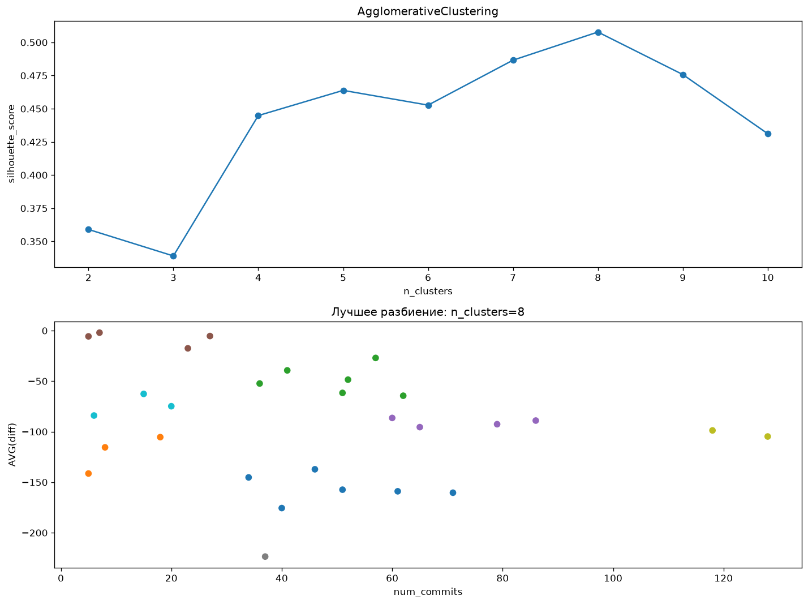

<details>
<summary>Посмотреть подбор параметров KMeans и DBSCAN</summary>

**KMeans:** сверху — оценка для разного количества кластеров, снизу — разбиение при `n_clusters=8`.

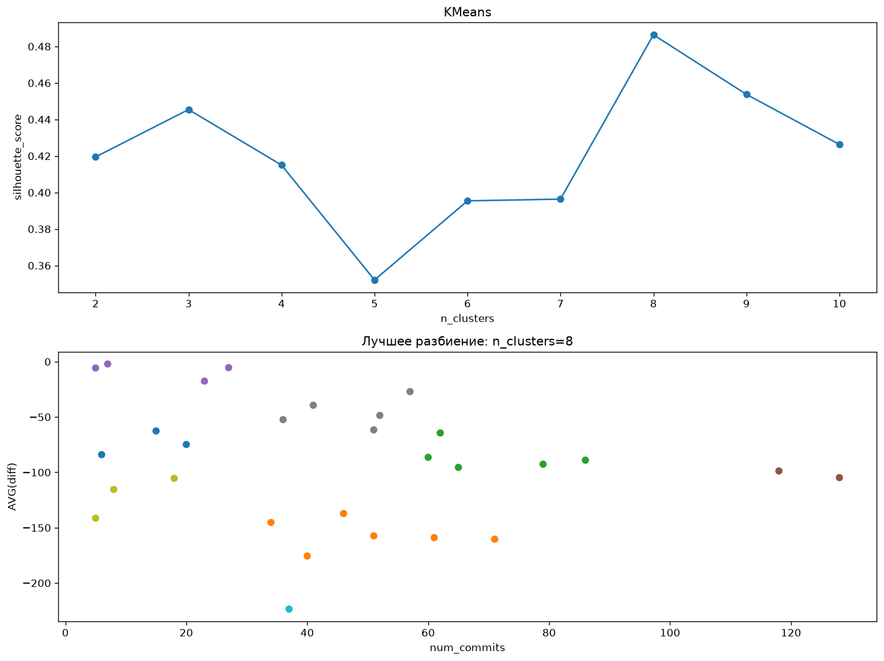

**DBSCAN:** сверху — изменение оценки при разных `eps`, снизу — результат при `eps=20` и `min_samples=2`.

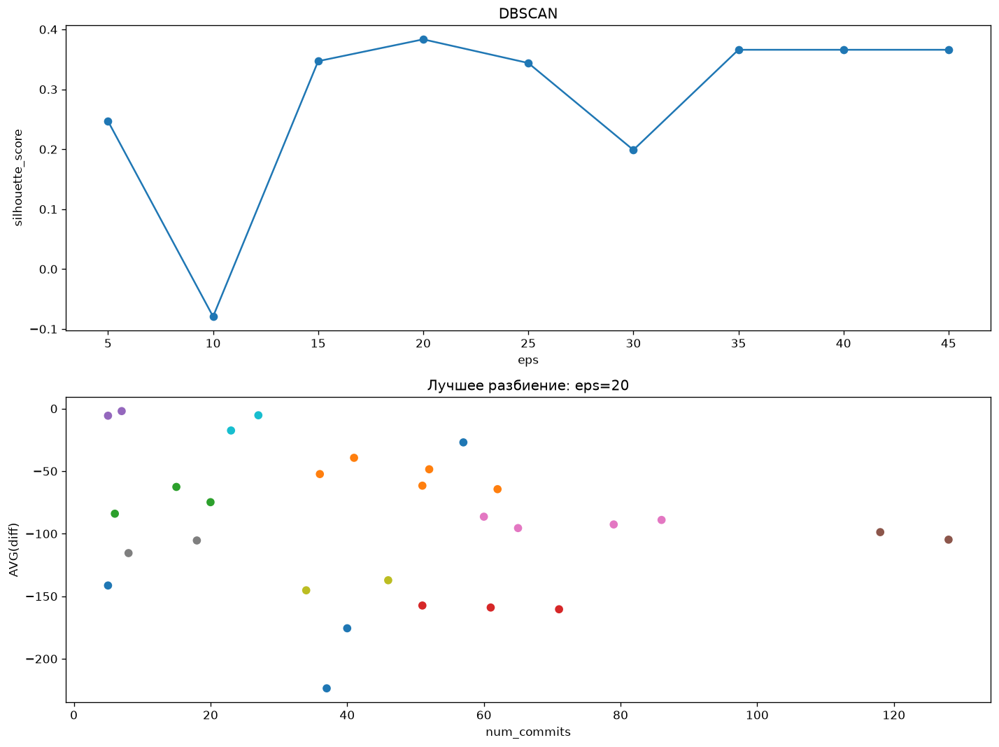

</details>

## Структура репозитория

```text
.
├── README.md
├── LICENSE
├── misc/
│   └── images/readme/          # 12 графиков для этой страницы
└── src/
    ├── data/                  # Исходные и подготовленные CSV
    ├── ex00/                  # Бинарная логистическая регрессия
    ├── ex01/                  # Стандартизация, SVC, дерево и границы
    ├── ex02/                  # Мультиклассовая классификация
    │   └── dayofweek.csv      # Подготовленные признаки для Ex03
    ├── ex03/                  # Train/test, CV, выбор модели
    │   └── ranfmodel.joblib    # Сохранённый случайный лес
    ├── ex04/                  # Регрессия и собственная crossval
    └── ex05/                  # Кластеризация и функция vizscore
```
